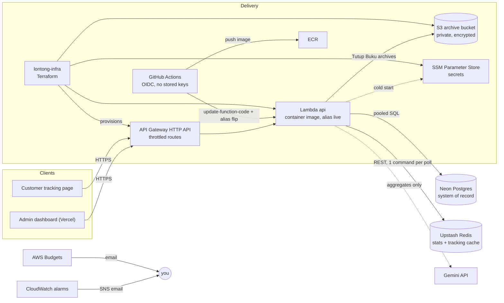

# lontong-infra

Terraform for the **Lontong Stack** backend on AWS serverless: Lambda (container image) behind API Gateway,
ECR, SSM Parameter Store, S3, plus Neon (Postgres) and Upstash (Redis) on their free plans.
Designed to be **almost free** (see `docs/cost-model.md`) and hard to misuse (separate state per environment, OIDC instead of keys).

> **Validation status.** The HCL parses and a cross-reference check (module inputs/outputs, variable declarations) passes, but this repo
> was written in a sandbox without access to the Terraform registry, so `terraform validate` / `plan` have **not** been run.
> Run `terraform fmt -recursive`, then `./scripts/tf.sh staging validate` and `plan` first, and read the plan before applying.

## Architecture



Why these choices: polling instead of SSE (`docs/adr/0002`), SSM instead of Secrets Manager and S3 locking instead of DynamoDB (`0003`),
a directory per environment (`0001`), WhatsApp automation deferred (`0004`). Region is **ap-southeast-1 (Singapore)**: Neon has no Jakarta region.

## Layout
```
bootstrap/      once per AWS account: state bucket, GitHub OIDC + CI roles, shared ECR repo, monthly budget
modules/        ecr, lambda_container, http_api, secrets, archive_bucket, observability, budgets, deploy_role, queue (unused: WhatsApp TODO)
environments/   staging/ and production/: same modules, separate state, separate values
optional/       neon-upstash/: Neon + Upstash as code (unvalidated, not wired in; the consoles are easier)
scripts/tf.sh   safe wrapper (unknown env refused, production apply asks for confirmation)
```

## Prerequisites
* An AWS account **on the Paid plan** (accounts created after 15 Jul 2025 on the Free plan close when credits/6 months end), Terraform >= 1.10, AWS CLI, Docker, Git.
* Service Quotas -> Lambda -> *Concurrent executions*: check the value; new accounts can start very low. Request an increase before using `lambda_reserved_concurrency`.
* A Neon project and an Upstash Redis database per environment (free plans; region Singapore). GitHub repos `lontong-infra` and `lontong-stack`.

## 1. Bootstrap (once)
```bash
cd bootstrap
terraform init
terraform apply -var state_bucket_name=lontong-tfstate-<ACCOUNT_ID> -var infra_repo=<you>/lontong-infra \
  -var 'budget_emails=["you@example.com"]'
# Optional but recommended: move bootstrap's own state into the new bucket
#   add:  terraform { backend "s3" { bucket="lontong-tfstate-<ACCOUNT_ID>" key="bootstrap/terraform.tfstate" region="ap-southeast-1" use_lockfile=true } }
#   then: terraform init -migrate-state
terraform output   # state_bucket, terraform_role_arns, ecr_repository_url
```
GitHub settings for **lontong-infra** (Settings -> Secrets and variables -> Actions): repository variables `STATE_BUCKET`, `TF_PLAN_ROLE_ARN`;
environments `staging` and `production` (production: *Required reviewers* = you) each with variable `TF_APPLY_ROLE_ARN`
(`lontong-tf-apply-staging` / `lontong-tf-apply-production` from the bootstrap output) and `STATE_BUCKET`.

## 2. First deploy of an environment (the "walking skeleton")
The Lambda needs an image to exist when it is created, so the very first image is pushed by hand:
```bash
export STATE_BUCKET=lontong-tfstate-<ACCOUNT_ID> REGION=ap-southeast-1 REPO=<ecr_repository_url>
aws ecr get-login-password --region $REGION | docker login --username AWS --password-stdin ${REPO%%/*}
docker build --target lambda -t $REPO:bootstrap ../lontong-stack/apps/api && docker push $REPO:bootstrap
# edit environments/staging/terraform.tfvars (TODO values), then:
./scripts/tf.sh staging plan  -var image_uri=$REPO:bootstrap
./scripts/tf.sh staging apply -var image_uri=$REPO:bootstrap
./scripts/tf.sh staging output
```
Then put the real secrets in (they were created as `__UNSET__` placeholders; the app refuses to start on a placeholder `JWT_SECRET`):
```bash
P=/lontong/staging
aws ssm put-parameter --overwrite --type SecureString --name $P/DATABASE_URL        --value 'postgresql+psycopg://...-pooler.../lontong?sslmode=require'   # Neon POOLED
aws ssm put-parameter --overwrite --type SecureString --name $P/DATABASE_URL_DIRECT --value 'postgresql+psycopg://.../lontong?sslmode=require'            # Neon DIRECT
aws ssm put-parameter --overwrite --type SecureString --name $P/JWT_SECRET          --value "$(openssl rand -base64 48)"
aws ssm put-parameter --overwrite --type SecureString --name $P/UPSTASH_REDIS_REST_URL   --value 'https://....upstash.io'
aws ssm put-parameter --overwrite --type SecureString --name $P/UPSTASH_REDIS_REST_TOKEN --value '...'
# optional product AI:  GEMINI_API_KEY (and set ai_enabled = true in tfvars)
```
Create the first admin and demo data against the **direct** URL: `DATABASE_URL_DIRECT=... ADMIN_PASSWORD=... python -m lontong.cli.seed --admin owner --demo` (from `lontong-stack/apps/api`), after running migrations (the app repo's deploy pipeline does this on every deploy).
Repeat for `production` with its own Neon project, Upstash database and values.

GitHub settings for **lontong-stack**: environments `staging` and `production` (production: required reviewers), each with variables
`AWS_REGION`, `AWS_DEPLOY_ROLE_ARN` (output `deploy_role_arn`), `ECR_REPOSITORY` (`lontong-api`), `LAMBDA_FUNCTION_NAME`, `API_URL` (output `api_url`).
From then on: merge to `main` => staging deploys automatically; production is a manual, approved promotion of the same image digest.

## Day-2 operations
| Task | How |
|---|---|
| Deploy | merge to `main` (staging); run **deploy-production** with the SHA that is on staging |
| Roll back | `aws lambda update-alias --function-name <fn> --name live --function-version <previous>` (the pipeline also does this when the smoke test fails) |
| Change infra | PR -> plan comment/artifact for both envs -> merge (staging auto-applies) -> run **terraform-apply-production** |
| Rotate a secret | `aws ssm put-parameter --overwrite ...`, then publish a new Lambda version or redeploy (secrets load at cold start) |
| Season start | create the season in the app (admin); optionally raise throttles/reserved concurrency before the peak |
| Tutup Buku | in the app: admin button with the typed confirmation. Backups land in the archive bucket (see `archive_bucket` output) |
| Tear down staging | `./scripts/tf.sh staging destroy` (the archive bucket must be emptied first; state bucket and ECR live in `bootstrap`) |

## Troubleshooting
* *`AccessDenied` pulling the image when creating the function*: your identity needs `ecr:BatchGetImage` + `ecr:GetDownloadUrlForLayer` on the repo; check you pushed to the same region/account.
* *`InvalidParameterValueException: ReservedConcurrentExecutions ... below the minimum`*: raise the account's Lambda concurrency quota or leave `lambda_reserved_concurrency = -1`.
* *`/readyz` returns 503*: database URL wrong or Neon unreachable; look at `/aws/lambda/lontong-<env>-api` logs. First request after idle is slower (Neon wakes, Lambda cold start).
* *App fails at startup with "JWT_SECRET must be set"*: the SSM parameter is still `__UNSET__`.
* *Python 3.14 images*: keep the image on 3.13 for now; Mangum relies on `asyncio.get_event_loop()`, which 3.14 no longer provides without a running loop.
* *Custom domain*: create the ACM certificate in ap-southeast-1, validate it at your DNS provider, set `custom_domain` + `certificate_arn`, then CNAME to the `custom_domain_target` output. Vercel can instead proxy `/api/*` to the API URL (same-origin: no CORS, cookies just work).
